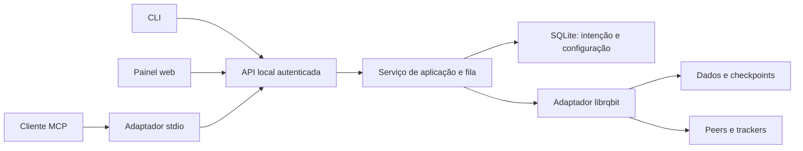

# Cliente BitTorrent leve — especificação proposta

Data: 2026-10-25. Estado: proposta para aprovação; não é software implementado.
Nome de trabalho: `torrent-lite`, sujeito a pesquisa de nome antes da publicação.

## Intenção e decisões

Construir um cliente open source, sem publicidade, bundles comerciais ou telemetria, prioritariamente para Windows, com baixo consumo e downloads confiáveis. Rust, painel web local, CLI e MCP foram aprovados como direção arquitetural. Os detalhes abaixo são propostas técnicas do autor, não decisões já aprovadas pelo usuário.

Alternativas consideradas: Go + anacrolix/torrent simplifica desenvolvimento, mas requer medir o coletor de lixo; Rust + librqbit permite controle de recursos sem GC e é a opção escolhida. Janela Tauri fica para depois: painel no navegador mantém a interface opcional. Não escrever um protocolo BitTorrent do zero.

O produto terá um executável, sem Node instalado na máquina do usuário. Ferramentas de frontend serão dependências somente de build. Windows x64 é a plataforma de lançamento; Linux x64 e macOS arm64 terão CI e serão experimentais até testes de integração próprios. Não exigir WSL ou privilégios administrativos.

## Escopo da primeira versão

- Magnet links BitTorrent v1 e arquivos .torrent v1, inclusive multifile; seleção de arquivos após resolução dos metadados.
- Fila, limites de upload/download, pausa, retomada, rechecagem, remoção do registro sem apagar os dados.
- Recuperação após reinício do processo ou computador; retomada quando o serviço for iniciado novamente. Inicialização automática com o Windows fica fora da primeira versão.
- CLI humana e JSON, servidor MCP stdio e painel responsivo em português e inglês.
- DHT, trackers e descoberta de peers via motor, conforme matriz de compatibilidade validada. Torrents privados devem desabilitar DHT/PEX e descoberta pública para aquele torrent; se o isolamento não for comprovado, rejeitá-los explicitamente no MVP.
- Progresso, bytes verificados, velocidade, peers, ETA quando calculável, erro acionável e estado de seeding.

Fora do MVP: busca de conteúdo, streaming, reprodução/execução automática, plugins, acesso remoto, contas na nuvem, atualizações automáticas, remoção física de arquivos, criação de torrents, proxy/VPN e integração com associações de arquivo. v2 e híbridos ficam fora até suporte comprovado; entradas não suportadas recebem erro específico, nunca sucesso parcial silencioso.

Não prometer velocidade superior a todos os clientes nem ausência de vulnerabilidades. Hashes comprovam integridade em relação ao torrent, não segurança do conteúdo.

## Arquitetura



Um único serviço por diretório de estado possui o motor, banco e arquivos. CLI/MCP nunca criam sessões de download independentes. Um lock do sistema operacional evita dois donos; arquivo de descoberta registra porta e versão, sem segredo acessível a outros usuários. A API de controle escuta exclusivamente 127.0.0.1 em porta dinâmica; sockets BitTorrent são separados e podem receber peers externos. Não habilitar UPnP ou mDNS automaticamente.

Componentes: domínio e operações; adaptador do motor; persistência; HTTP; CLI; MCP; frontend estático. Um workspace Rust com módulos/crates pequenos, sem abstração genérica para vários motores antes de haver necessidade. Tokio para concorrência, clap para CLI, serde para contratos; bibliotecas de HTTP, SQLite e SDK MCP serão fixadas no plano após checar versões/licenças. Cargo.lock versionado.

`serve` roda em primeiro plano; `start` inicia serviço desacoplado sem janela de console extra no Windows; `stop` encerra o serviço. `ui` inicia se necessário e abre o navegador. Fechar a aba não interrompe downloads. `mcp` conecta ao serviço e pode iniciá-lo pelo mesmo mecanismo com lock, esperando readiness por até 10 s. Sair do MCP não encerra o serviço. Operações CLI comuns retornam erro claro se o serviço estiver parado.

## Contratos e comportamento

Comandos propostos:

```text
torrent-lite start | serve | stop | status | ui
torrent-lite add <magnet-ou-arquivo.torrent> [--paused]
torrent-lite list [--json]
torrent-lite inspect <id> [--json]
torrent-lite pause <id>
torrent-lite resume <id>
torrent-lite verify <id>
torrent-lite remove <id>
torrent-lite config show
```

IDs estáveis próprios, independentes dos IDs transitórios do motor. Adicionar mesmo infohash devolve o registro existente; destino ou seleção conflitantes retornam conflito. Cada torrent recebe subdiretório isolado pelo ID dentro de uma raiz configurada. Não sobrescrever arquivos preexistentes sem identidade comprovada. CLI não interpreta entrada como shell.

API `/api/v1`: adicionar, listar com paginação, inspecionar, pausar, retomar, verificar, remover registro, selecionar arquivos e atualizar limites. Leitura de progresso por polling a cada 1 s enquanto a aba está visível, 10 s quando oculta. Payload com estado, bytes totais/selecionados/verificados, taxas, peers e ETA nullable. Erros estruturados `{code,message,retryable}` sem detalhes secretos. Operações longas retornam job ID; repetição de pausa/retomada é idempotente. Mutação por torrent serializada; verificar/remove concorrentes retornam conflito ou entram em fila explicitamente.

Estados: resolving_metadata, queued, checking, downloading, paused, completed, seeding, error. Persistir separadamente intenção de rodar/pausar e estado observado. Pause sobrevive a reinícios. `resume` preserva dados e valida antes de reutilizar; `verify` suspende tráfego daquele torrent, percorre peças e depois restaura intenção anterior. `remove` cancela jobs e remove registro/checkpoint, preservando todos os arquivos baixados. Download do zero com apagamento deliberado fica fora do MVP.

Seeding: compartilhar durante download; após concluir, padrão proposto de parar quando razão upload/download atingir 1,0 ou após 60 minutos de seeding, o que vier primeiro. Permitir configurar ilimitado ou parar ao concluir. Persistir contadores/tempo; mostrar política na interface. A política final precisa ser validada com capacidades do motor, sem inventar contadores.

## Persistência, restart e integridade

SQLite transacional armazena identidade, metadados necessários, seleção, destino, intenção, limites e esquema versionado. O motor cuida de suas peças/checkpoints em área separada; nunca usar dois mecanismos concorrentes como autoridades da intenção. Banco é autoridade do que deve existir; checkpoints são sugestões de progresso e podem ser descartados/reconstruídos. Remoção registra intenção antes de limpar checkpoint, para impedir ressurreição após crash.

No início, reconciliar banco/motor e verificar arquivos existentes antes de anunciar peças completas. No MVP, rechecagem completa de peças existentes ao reabrir sessão, mesmo após parada limpa: mais I/O, correção mais simples. Não carregar arquivos inteiros na RAM. Peças inválidas são descartadas logicamente e requisitadas de novo; peças válidas não devem ser baixadas novamente. `completed` só após todas as peças necessárias terem hashes válidos. Seleção parcial pode exigir bytes de arquivos vizinhos para validar peças compartilhadas; explicar e contabilizar esses bytes na interface.

Checkpoint de intenção em cada mutação; contadores a cada 5 s e no shutdown, sem promessa de contagem exata após corte abrupto. Encerramento tenta parar rede e sincronizar por até 10 s; se exceder, próximo início realiza recuperação. Disco cheio, arquivo bloqueado ou destino removido pausam a tarefa em erro recuperável, preservando dados. Migrações fazem backup e falham de forma fechada se a versão não for suportada. Corrupção do banco não autoriza apagar ou rebaixar os arquivos.

## Segurança e limites

Entradas torrent, nomes de peers e respostas de rede são não confiáveis. Rejeitar caminhos absolutos, `..`, UNC, letras de drive, NTFS alternate streams, nomes reservados e colisões de nomes/case; impedir symlinks/junctions/reparse points de escapar do destino, incluindo corrida entre validação e abertura. Essa proteção deve existir na camada que abre arquivos, não apenas em validação textual. Limites de profundidade, comprimento, contagem e metadados precisam ser aplicados antes de alocações grandes.

Valores iniciais propostos: metainfo até 8 MiB, magnet até 16 KiB, até 10.000 arquivos por torrent, 100 torrents registrados, 3 ativos, 150 peers totais e 50 por torrent. Excesso retorna erro explícito ou fica em fila conforme o limite; limites ajustáveis dentro de faixas documentadas. Fila de requisições e buffers também devem ser limitados. Downloads sem cap de taxa por padrão; limites de memória/peers impedem crescimento ilimitado.

Token aleatório de 256 bits salvo com ACL/permissões do usuário. API exige Bearer; validar Host exato e Origin, sem CORS aberto. Painel obtém sessão por código de uso único (60 s) no fragmento da URL; troca autenticada restrita ao Origin correto, limpa fragmento e usa cookie HttpOnly SameSite=Strict; mutações exigem token CSRF. Segredos nunca em query string ou logs. CSP sem scripts remotos, sem CDN, texto de torrent nunca vira HTML. Exigir JSON e limites de corpo/timeout.

Restringir tracker/peer de entrada não confiável contra acesso a loopback, link-local, redes privadas e endpoints de metadados por padrão, validando IP após DNS e em redirects; modo LAN explícito permite redes privadas para testes/uso local. Não aceitar URLs HTTP de arquivos torrent no MVP; bytes vêm do upload ou leitura explícita da CLI. Desabilitar web seeds até haver política equivalente verificada. Se a biblioteca não permitir esses controles, é bloqueador de segurança, não requisito a omitir.

MCP usa SDK compatível com uma revisão fixada e testada do protocolo, negociação de versão, initialize, tools/list e tools/call; stdout só para mensagens MCP, logs em stderr. Ferramentas: torrent_add, torrent_list, torrent_inspect, torrent_pause, torrent_resume, torrent_verify, torrent_remove. Adição recebe magnet ou metainfo base64 limitado; não permite ler caminho arbitrário do host. Sem execução de comandos, apagamento físico ou mudança livre do destino. Modo `--read-only` expõe apenas consultas. Anotações MCP não substituem autorização.

## Interface proposta

Uma tela com campo de magnet e botão para .torrent, resumo de velocidades e lista de downloads. Cada item exibe nome, progresso verificado, estado, velocidade/ETA e ações contextuais. Detalhes mostram arquivos e seleção, peers, destino, política de seeding e erro. Não mostrar percentuais fictícios durante resolução de metadados. Estados vazios, desconexão e reconexão devem ser claros. Remover registro explica que os arquivos ficam no disco.

CSS próprio, fontes do sistema, temas claro/escuro, foco visível, navegação por teclado, rótulos acessíveis e respeito à preferência de movimento reduzido. Paginação e renderização incremental para não recriar toda a lista a cada atualização. Alvo de assets de produção até 250 KiB gzip, sem fontes externas. Mockup visual será uma etapa própria antes de finalizar o frontend.

## Desempenho: metas, não resultados

Antes de afirmar leveza, publicar ambiente e medidas. Metas iniciais para release Windows x64: serviço ocioso até 40 MiB de private bytes, CPU média abaixo de 1% em 60 s; um torrent de 4 GiB, peças de 1 MiB e 50 peers até 120 MiB de private bytes de pico. Medir também working set/RSS e memória do navegador separadamente, com total agregado do cenário. Metas podem exigir revisão documentada após benchmark, nunca mudar silenciosamente.

Comparar wrapper com librqbit sem wrapper, mesma versão e opções. Cinco execuções com swarm controlado, seeders fora do processo, dados conhecidos, mesmas condições de cache/rede/disco; registrar mediana, p95 e pico, incluindo período de verificação. Alvo de throughput mediano pelo menos 95% do motor base. CI compartilhada não serve como prova de throughput; benchmark dedicado e reproduzível. Comparação com outros clientes é complementar, não promessa de liderança.

## TDD e critérios de aceitação

Cada comportamento começa com teste que falha pela causa esperada, implementação mínima e refatoração. Registrar comando e falha/passe no trabalho de implementação. Testes não dependem de trackers públicos ou downloads de terceiros.

1. Torrent e magnet de fixture local completam com bytes iguais à origem; magnet resolve sem conteúdo prévio.
2. Encerrar processo à força a 30–70%, reabrir e concluir; peças válidas reaproveitadas, estado paused preservado e sem registro duplicado.
3. Corromper peça e revalidar; detectar e reparar apenas peças inválidas, incluindo peças que atravessam arquivos.
4. Disco cheio, acesso negado, destino ausente e arquivo bloqueado produzem erro recuperável, sem perda de outros torrents.
5. Traversal, junction/symlink, colisões Windows, torrent malformado, excesso de metadados e seleção inválida são rejeitados.
6. API nega token errado, Origin/Host indevidos e CSRF; logs não vazam credenciais. DNS/redirects não contornam política de rede.
7. Dois clientes iniciando simultaneamente compartilham um serviço; pause/remove/verify concorrentes têm resultado determinístico.
8. MCP negocia versão, lista schemas corretos, chama operações reais e mantém stdout válido; modo somente leitura nega mutações.
9. UI permite adicionar, pausar, retomar e verificar; fechar aba preserva download; erro/reconexão e teclado testados em navegador.
10. Estado/banco/checkpoint divergentes, crash durante remoção e migração interrompida não ressuscitam tarefas removidas nem apagam conteúdo.

Testes unitários de domínio; integração com armazenamento real temporário; testes de processo e swarm local; fuzzing dos limites de entrada; testes Windows nativos para reparse points/locks e semântica NTFS. Toda entrega roda fmt, clippy e suíte completa; relatórios indicam plataformas e testes realmente executados.

## Comunidade, distribuição e 12-factor

Proposta de licença Apache-2.0 para código próprio, mantendo atribuições de dependências. Antes de publicar: README com limites reais, CONTRIBUTING, CODE_OF_CONDUCT, SECURITY com canal privado funcional, changelog, versionamento semântico, issue/PR templates, SBOM, checksums e proveniência do build. Não inventar contato de segurança ou autoria. Assinatura Windows depende de identidade/certificado do mantenedor; sem isso, distribuir como não assinado e documentar honestamente. Builds reproduzíveis são objetivo com comparação independente antes de alegar garantia.

Aplicar 12-factor onde útil: código versionado, dependências fixadas, build separado de execução, configuração externa, logs como fluxo e desligamento limpo. Não impor processo sem estado nem banco remoto a um cliente local. Configuração em arquivo TOML, sobreposta por ambiente e flags; segredos em armazenamento protegido, sem flags que os exponham. Configurar raiz de download explicitamente na primeira execução. Diretórios de estado seguem convenções do SO, com opção portable explícita.

## Gate técnico e sequência

Após aprovação desta especificação, escrever plano de implementação com fases independentes: (1) avaliação do motor e provas de integração, (2) núcleo/persistência/CLI, (3) API segura/MCP, (4) painel, (5) benchmarks e distribuição. Não publicar como utilizável antes de completar as três interfaces e testes de recuperação.

O gate do motor verifica versão fixada, árvore de licenças, features mínimas, limites de recursos, verificação forçada, recuperação, arquivos selecionados, torrents privados, proteção de caminhos e controle de destinos de rede. A documentação pública não prova todos esses itens. Se falhar, registrar lacuna e avaliar correção upstream ou alternativa; não trocar arquitetura nem alegar conformidade silenciosamente. Nenhum código ou dependência foi instalado nesta etapa.

## Fontes consultadas

- https://github.com/ikatson/rqbit — projeto com biblioteca, CLI e web UI; reutilização como dependência, não reinvenção do protocolo.
- https://raw.githubusercontent.com/ikatson/rqbit/main/LICENSE — licença Apache-2.0 na branch consultada; rever artefato fixado e dependências antes de distribuir.
- https://docs.rs/librqbit/latest/librqbit/ — documentação consultada exibe 9.0.1 e tipos de sessão/persistência; versão candidata, ainda não fixada.
- https://docs.rs/librqbit/latest/librqbit/struct.Session.html — operações de sessão, pausa e retomada; comportamento efetivo exige testes.
- https://modelcontextprotocol.io/specification/2025-06-18/basic/transports — referência de stdio/segurança; escolher revisão suportada pelo SDK no plano.
- https://github.com/anacrolix/torrent — alternativa de motor em Go.
